# ansible-template — Redis Sentinel và HAProxy

Ansible cài hai thành phần hạ tầng cho hệ thống chạy trên cụm Kubernetes, máy chủ Ubuntu 24.04, **cài trực tuyến** (máy chủ tự tải gói từ Internet):

| Thư mục | Cài gì | Số máy |
|---|---|---|
| [`redis/`](redis/) | Redis 7.4 (kho `packages.redis.io`, ghim dòng 7.4) + Sentinel + keepalived VIP đi theo master (VIP tùy chọn). Cấu hình sẵn cho hàng đợi BullMQ (`noeviction`, AOF) | 3 |
| [`haproxy/`](haproxy/) | HAProxy (kho Ubuntu, 24.04 là dòng LTS 2.8) + keepalived VIP (tùy chọn), cổng vào từ Internet đẩy vào Ingress cụm Kubernetes | 2 |

MariaDB không nằm ở đây (bên khác cài).

Có hai cách cài:

- **Qua SSH** (`setup`): Ansible trên máy điều khiển SSH vào từng máy chủ.
- **Không SSH** (`bundle`): dùng khi các máy không mở cổng 22 cho nhau, chỉ vào được từng máy qua Teleport. Ansible sinh sẵn cho mỗi máy một thư mục gồm tệp cấu hình và `install.sh`; chép lên từng máy rồi chạy. Xem mục [Cài không qua SSH](#cài-không-qua-ssh-bundle).

**VIP là tùy chọn** cho cả hai nhóm: để trống `REDIS_VIP` / `HAPROXY_VIP` trong `.env` thì không cài keepalived. Có IP trống sau thì điền vào rồi chạy lại.

## Mô hình

```mermaid

flowchart LR
   U["Internet"] -->|"HTTPS 443 / HTTP 80 → 443"| HV{"VIP HAProxy"}

   subgraph HA["HAProxy HA Cluster"]
      direction TB
      H1["HAProxy-1 (Active)"]
      H2["HAProxy-2 (Standby)"]
      H1 -.->|"Failover"| H2
   end

   HV --> H1
   HV -.-> H2

   H1 --> I["Kubernetes Ingress"]
   H2 -.-> I

   subgraph K8S["Kubernetes Cluster"]
      direction TB
      I --> APP["API / Worker"]
   end

   APP -->|"Redis AUTH / TCP 6379"| RV{"Redis VIP"}

   subgraph REDIS["Redis Sentinel Cluster"]
      direction TB
      R1[("Redis Master + Sentinel")]
      R2[("Redis Replica-1 + Sentinel")]
      R3[("Redis Replica-2 + Sentinel")]

      R1 -->|"Replication"| R2
      R1 -->|"Replication"| R3
      R2 <-.->|"Sentinel Quorum"| R3
   end

   RV --> R1
   RV -.->|"Failover"| R2
   RV -.->|"Failover"| R3

   classDef vip fill:#fef3c7,stroke:#d97706,color:#92400e,stroke-width:2px
   classDef active fill:#dcfce7,stroke:#16a34a,color:#166534
   classDef standby fill:#f1f5f9,stroke:#64748b,color:#334155
   classDef k8s fill:#dbeafe,stroke:#2563eb,color:#1e40af
   classDef redis fill:#fee2e2,stroke:#dc2626,color:#991b1b

   class HV,RV vip
   class H1,R1 active
   class H2,R2,R3 standby
   class I,APP k8s

```



**Redis.** Ba nút: 1 master và 2 replica, mỗi nút có một Sentinel (quorum 2). Ứng dụng hiện chỉ nhận **một** địa chỉ Redis (`REDIS_URL`), nên khi có `REDIS_VIP` thì thêm VIP keepalived. Script kiểm tra trên mỗi nút chỉ đạt khi Sentinel cục bộ coi nút đó là master **và** Redis cục bộ đang `ROLE master`. Nhờ vậy, khi Sentinel chuyển master, VIP đi theo sau vài giây và ứng dụng không phải đổi cấu hình. Chưa có VIP thì `REDIS_URL` trỏ thẳng IP master; Sentinel chuyển master thì phải đổi tay `REDIS_URL` (cho tới khi ứng dụng hỗ trợ danh sách Sentinel).

**HAProxy.** Có `HAPROXY_VIP`: máy active giữ VIP. Khi HAProxy chết, độ ưu tiên giảm 60 (150 → 90 < 100) nên VIP chuyển sang máy standby. Chưa có VIP: mỗi máy nhận trên IP riêng, DNS hoặc tường lửa trỏ vào.

## Chuẩn bị

1. Máy điều khiển cần `ansible-core` ≥ 2.15. Chỉ dùng module `ansible.builtin.*`, không cần collection nào khác.
   ```bash
   python3 -m venv ~/.venvs/ansible && ~/.venvs/ansible/bin/pip install ansible-core
   ```
2. Tạo `.env` từ mẫu, rồi thay mọi `${...}` bằng giá trị thật. **Không commit `.env`** (đã có trong `.gitignore`).
   ```bash
   cp .env.example .env && chmod 600 .env
   ```
   Tạo mật khẩu: `openssl rand -base64 32 | tr -d '/+='`. Chỉ dùng chữ, số và `. _ ~ -`, tối thiểu 16 ký tự. Các mật khẩu Redis phải khác nhau. `*_VRRP_AUTH_PASS` dài 4–8 ký tự.
3. Chép khóa SSH lên máy chủ. Lần đầu sẽ hỏi mật khẩu SSH.
   ```bash
   scripts/setup-ssh-keys.sh
   ```
   Nếu `sudo` cần mật khẩu, đặt `ANSIBLE_BECOME_ASK_PASS=true` trong `.env`.

### Mạng — kiểm tra trước khi chạy

- (Khi có VIP) **VIP phải là IP trống** trong cùng mạng với card `*_VIP_INTERFACE`.
- (Khi có VIP) Trên cloud (OpenStack và tương tự), port của từng máy phải **cho phép VIP** (allowed address pairs), nếu không gói tin tới VIP bị chặn.
- (Khi có VIP) Mở **VRRP (giao thức IP 112)** giữa các máy cùng nhóm.
- Redis: mở 6379 và 26379 giữa 3 máy Redis, và từ các nút Kubernetes tới IP nội bộ Redis cùng VIP.
- HAProxy: mở 80, 443 từ Internet tới VIP; từ HAProxy tới cổng Ingress của các nút Kubernetes; 8404 (thống kê, `/metrics`) chỉ từ máy giám sát.
- Máy chủ ra được Internet: Redis cần `packages.redis.io`, cả hai nhóm cần kho Ubuntu.

## Chạy

```bash
scripts/run.sh redis preflight      # kiểm tra .env, SSH, card mạng, Internet, đĩa
scripts/run.sh redis setup          # cài + cấu hình + kiểm tra
scripts/run.sh redis verify         # chỉ kiểm tra lại

scripts/run.sh haproxy preflight
scripts/run.sh haproxy setup
scripts/run.sh haproxy verify
```

Mọi tham số sau tên playbook được chuyển thẳng cho `ansible-playbook`, ví dụ `--check --diff`, `--limit redis-2`, `-e redis_maxmemory=10gb`.

`setup` chạy lại được nhiều lần:

- **Redis.** Cấu hình áp **từng máy một** (`serial: 1`). Master được lấy theo Sentinel, nên chạy lại sau khi đã chuyển master không kéo master về máy 1. Đổi ACL được nạp nóng (`ACL LOAD`), không khởi động lại. `sentinel.conf` chỉ ghi lần đầu vì Sentinel tự ghi trạng thái vào tệp đó; muốn ghi lại thì thêm `-e redis_sentinel_reconfigure=true`.
- **HAProxy.** Cấu hình được kiểm tra (`haproxy -c`) trước khi thay. Áp bằng `reload`, không cắt kết nối đang chạy.

Gỡ để cài lại (qua SSH):

```bash
scripts/run.sh redis clear -e confirm_clear=yes                    # giữ dữ liệu
scripts/run.sh redis clear -e confirm_clear=yes -e clear_data=yes  # xóa cả dữ liệu, bản sao lưu
scripts/run.sh haproxy clear -e confirm_clear=yes
```

## Cài không qua SSH (bundle)

Dùng khi các máy không SSH được tới nhau (ví dụ chỉ vào từng máy qua Teleport). Ansible chạy **một lần trên máy của đồng chí**, không kết nối tới máy chủ nào; các máy chủ **không cần cài Ansible**.

1. Điền `.env` như mục Chuẩn bị. Để trống các biến SSH (`ANSIBLE_SSH_*`, `*_SSH_HOST`); IP nội bộ (`REDIS_n_IP`, `HAPROXY_n_IP`) vẫn bắt buộc.
2. Sinh gói:
   ```bash
   scripts/run.sh redis bundle
   ```
   ```bash
   scripts/run.sh haproxy bundle
   ```
   Kết quả nằm ở `bundle/redis/redis-1/`, `redis-2/`, `redis-3/`, `bundle/haproxy/haproxy-1/`, `haproxy-2/`. Mỗi thư mục gồm `install.sh`, `verify.sh` và `files/`.
3. Chép **đúng thư mục của máy nào lên máy đó**, ví dụ bằng `tsh scp -r bundle/redis/redis-1 root@<máy>:/root/` hoặc tải tệp lên qua giao diện web Teleport (nén `tar czf` trước cho tiện).
4. Trên từng máy, chạy bằng root:
   ```bash
   sudo bash install.sh
   ```
   Thứ tự Redis: **redis-1 (master) trước**, rồi redis-2, redis-3. Xong cả ba thì chạy `sudo bash verify.sh` trên một máy bất kỳ. Với HAProxy, chạy `install.sh` rồi `verify.sh` trên từng máy.
5. **Xóa thư mục gói trên máy chủ và trên máy mình sau khi cài.** Gói chứa mật khẩu và khóa TLS; `bundle/` đã có trong `.gitignore`.

Các máy Redis tự nối với nhau qua IP nội bộ (nhân bản cổng 6379, Sentinel cổng 26379). **Không cần SSH giữa các máy, nhưng hai cổng này phải mở giữa 3 máy Redis.** `install.sh` trên replica sẽ báo lỗi rõ ràng nếu không nối được master.

`install.sh` làm đúng các bước như `setup`: cài gói (ghim 7.4), tạo user và thư mục, sysctl, đặt cấu hình, bật dịch vụ, chờ đồng bộ, Sentinel, keepalived (nếu có VIP), sao lưu. Chạy lại được nhiều lần; chỉ khởi động lại khi cấu hình đổi. Sửa `.env` thì sinh lại gói, chép lại và chạy lại `install.sh`.

Gói sinh cho lần cài đầu, coi máy `redis_initial_role: master` là master. Cụm đã chạy và Sentinel đã chuyển master thì khi sinh lại phải chỉ rõ master hiện tại: `scripts/run.sh redis bundle -e redis_current_master_ip=<IP>`.

## Nối ứng dụng

Đặt biến cho api và worker (Secret của Kubernetes):

```
REDIS_URL=redis://vtvl:<REDIS_APP_PASSWORD>@<REDIS_VIP>:6379
```

Chưa có VIP: thay `<REDIS_VIP>` bằng IP nội bộ của master (lần đầu là `REDIS_1_IP`). `verify` in sẵn dòng này với đúng địa chỉ.

Người dùng ACL do playbook tạo. Mật khẩu lưu dạng băm SHA-256 trong `users.acl`.

| Người dùng | Dùng cho | Quyền |
|---|---|---|
| `default` | Người vận hành, sao lưu, script VIP | Toàn quyền |
| `vtvl` | API (Spring Session, Spring Data Redis), worker (BullMQ) | Mọi lệnh dữ liệu, Lua, pub/sub. Chặn `@admin` và `@dangerous` (FLUSHALL, KEYS, CONFIG, DEBUG, SHUTDOWN, ACL…), chỉ mở lại `INFO` và `CLIENT SETNAME/SETINFO/...` |
| `replicator` | Nhân bản giữa các nút | `PSYNC`, `REPLCONF`, `PING` |
| `sentinel-monitor` | Sentinel theo dõi, chuyển master | Theo danh sách quyền trong tài liệu Sentinel |
| `exporter` | redis_exporter (Prometheus) | `INFO`, `CONFIG GET`, `SLOWLOG`… Không đọc nội dung khóa |

Bước `verify` thử đúng các lệnh ứng dụng dùng, qua VIP (hoặc IP master khi chưa có VIP): `PING`, `CLIENT SETNAME`, `INFO`, `SET`, `EVAL`, `PUBLISH`, `DEL`. Bước này cũng xác nhận `FLUSHALL` và `CONFIG SET` bị chặn.

Ứng dụng mới cần lệnh bị chặn: sửa `redis_app_acl_rules` trong [`redis/ansible/group_vars/all.yml`](redis/ansible/group_vars/all.yml), rồi chạy lại `setup`.

### Lưu ý cho BullMQ

- `maxmemory-policy noeviction` là bắt buộc. Đầy bộ nhớ thì lệnh ghi bị từ chối, thay vì âm thầm xóa việc trong hàng đợi. Nên cảnh báo từ 80% `maxmemory` (mặc định 8 GB trên máy 16 GB, chừa chỗ cho fork khi BGSAVE và viết lại AOF).
- `timeout 0`: không cắt kết nối rảnh, vì lệnh chặn của BullMQ có thể chờ lâu.
- `min-replicas-to-write 1`: master ngừng nhận ghi khi không còn replica nào theo kịp trong 10 giây, để hạn chế mất dữ liệu khi tách mạng. Hệ quả: nếu mất cùng lúc 2 replica thì hàng đợi dừng ghi. Đặt `-e redis_min_replicas_to_write=0` nếu ưu tiên sẵn sàng hơn.
- Khi chuyển master, kết nối đang mở bị đóng. ioredis và Lettuce tự nối lại vào VIP. BullMQ cần `maxRetriesPerRequest: null`, và worker đã đặt sẵn.

## HAProxy — chế độ TLS

`HAPROXY_TLS_MODE` trong `.env`:

| | `terminate` (mặc định) | `passthrough` |
|---|---|---|
| Chứng chỉ | Ở HAProxy (`HAPROXY_TLS_PEM_FILE`: chứng chỉ + chuỗi trung gian + khóa riêng, trên máy điều khiển) | Ở Ingress |
| Ingress nhận | HTTP | HTTPS |
| `X-Forwarded-Proto/Host/Port/For` | HAProxy gắn (Keycloak `KC_PROXY_HEADERS=xforwarded`, API `forward-headers-strategy` cần) | Ingress phải tự gắn |
| Chặn `/auth/admin`, `/auth/realms/master` từ Internet | Có (trả 404) | Không, phải chặn ở Ingress |
| Tiêu đề bảo mật (HSTS, nosniff, X-Frame-Options, Referrer-Policy, bỏ `Server`) | Có | Không |

Một số giá trị đã chỉnh sẵn cho ứng dụng:

- `tune.bufsize 81920`, vì API nhận tiêu đề tới 64 KB.
- `timeout server 300s`, cho xuất và nhập Excel lớn.
- Giới hạn tốc độ theo IP đang **tắt**, vì nhiều đơn vị đi Internet qua chung một IP NAT. Bật bằng `haproxy_rate_limit_enabled: true`.

Thống kê và Prometheus chỉ nghe trên IP nội bộ của máy: `http://<HAPROXY_n_IP>:8404/stats` và `/metrics`, đăng nhập bằng `HAPROXY_STATS_USER/PASSWORD`.

## Cấu trúc

```
.env.example              # mẫu biến, ${...} điền sau
scripts/run.sh            # nạp .env rồi chạy playbook
scripts/setup-ssh-keys.sh
redis/ansible/
  inventory/hosts.yml     # 3 máy, đọc IP từ .env
  group_vars/all.yml      # mọi tham số Redis/Sentinel/ACL/VIP
  playbooks/{preflight,setup,verify,clear,bundle}.yml
  tasks/redis-*.yml
  templates/              # redis.conf, users.acl, sentinel.conf, unit systemd, keepalived, sao lưu,
                          # install.sh / verify.sh của bundle
haproxy/ansible/
  inventory/hosts.yml     # 2 máy (active, standby)
  group_vars/all.yml
  playbooks/{preflight,setup,verify,clear,bundle}.yml
  tasks/haproxy-*.yml
  templates/              # haproxy.cfg, keepalived
```

## Vận hành

| Việc | Lệnh (trên máy Redis) |
|---|---|
| Master hiện tại | `REDISCLI_AUTH=… redis-cli -p 26379 SENTINEL get-master-addr-by-name vtvl-redis` |
| Chuyển master có chủ đích | `REDISCLI_AUTH=… redis-cli -p 26379 SENTINEL failover vtvl-redis` |
| Trạng thái nhân bản | `REDISCLI_AUTH=… redis-cli INFO replication` |
| Sao lưu tay | `sudo /usr/local/sbin/redis-backup.sh` (tự chạy 02:20 hằng ngày, giữ 7 ngày ở `/data/redis-backup`) |
| Nhật ký | `/logs/redis/redis.log`, `/logs/redis/sentinel.log`, `journalctl -u keepalived` |

Dịch vụ systemd: `vtvl-redis`, `vtvl-redis-sentinel`, `keepalived`. Unit `redis-server` của gói bị mask.
